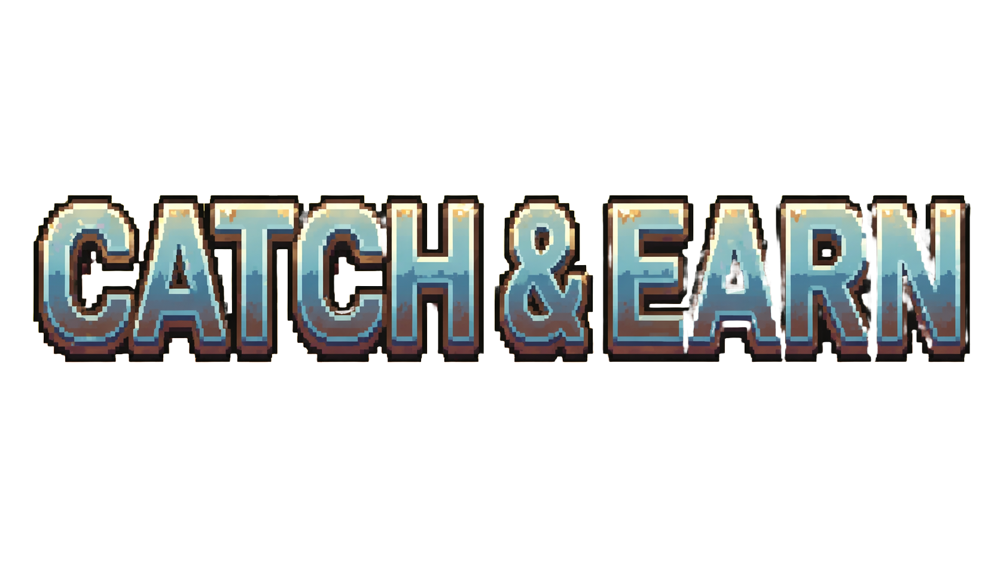
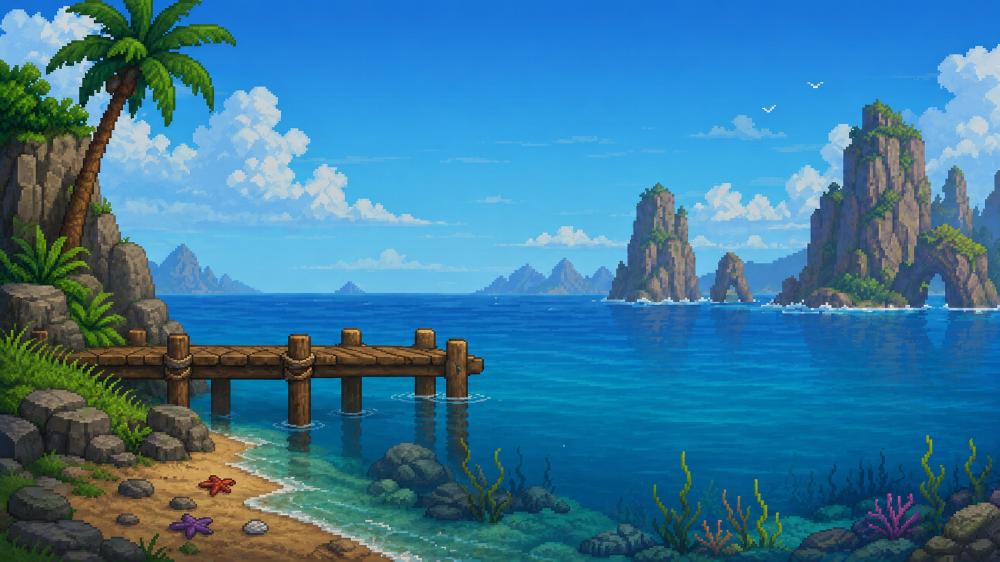

# Catch & Earn

<p align="center">
  
</p>

**Catch & Earn** is a cross-platform 2D fishing clicker with collection and RPG progression mechanics. Catch fish in a reaction-based mini-game, earn coins, buy upgrades, unlock a new location, and work your way toward the Winner's Crown.

Built with **C#**, **.NET 8**, and **Avalonia UI 12** using an MVC-style architecture.


## Play on Windows

1. Open the [latest release](https://github.com/ssimchenko/CatchAndEarn/releases/latest) and download `CatchAndEarn-Windows-x64.zip` under **Assets**.
2. Extract the entire archive.
3. Open the extracted folder and run `CatchAndEarn.exe`.

Requires 64-bit Windows. VS Code and .NET do not need to be installed. Keep the other extracted files alongside the executable.

The same archive is also available in the repository: [Windows x64 build](./builds/CatchAndEarn-Windows-x64.zip).

<p align="center">
  
</p>

## Gameplay

1. Cast the line and wait for a bite.
2. Stop the moving marker inside the success zone.
3. Collect fish and earn coins.
4. Buy upgrades that affect difficulty, rewards, and catch chances.
5. Unlock the second location and purchase the Winner's Crown.

Rare fish move faster and have a smaller success zone. At higher difficulty levels, the zone also moves across the bar.

## Key Features

- 30 fish species with different rarity, difficulty, and rewards
- Two locations: **Deep Pond** and **C# Sea**
- Reaction-based SkillCheck running at approximately 60 FPS
- Weighted random catch system with rarity bonuses
- Fish collection and upgrade shop
- Seven upgrade types, including a Golden Lure and Trophy Net
- Pixel-art interface with hover and pressed states
- Background music, sound effects, and independent mute controls
- Cross-platform support for Windows, macOS, and Linux

## Tech Stack

- **C# / .NET 8**
- **Avalonia UI 12.0.1** and XAML
- **MVC-style architecture**
- `DispatcherTimer` for real-time UI updates
- Events and actions for Model-to-View communication
- `HashSet` collections for caught fish and purchased upgrades
- `System.Diagnostics.Process` for platform-specific audio playback

## Architecture

```text
CatchAndEarn/
├── Model/       # Game entities, player state, fishing, audio, SkillCheck
├── View/        # Avalonia UI, screens, animations, and user input
├── Controller/  # Rewards, purchases, and upgrade effects
└── Assets/      # Pixel-art graphics and audio
```

The game logic is separated from the interface:

- `FishingService` performs weighted random selection and applies rarity bonuses.
- `SkillCheck` calculates marker speed and success-zone movement.
- `GameController` handles rewards, purchases, and coin multipliers.
- `Player` keeps the current balance, collection, location, and upgrades.
- `MainWindow` renders the state and manages transitions between screens.

## Run from source

### Requirements

- [.NET 8 SDK](https://dotnet.microsoft.com/download/dotnet/8.0)
- Windows 10+, macOS 10.15+, or Linux
- `aplay` on Linux for audio playback

### Run locally

```bash
git clone https://github.com/ssimchenko/CatchAndEarn.git
cd CatchAndEarn
dotnet restore
dotnet run
```

## What I Learned

This project helped me practise desktop UI development, event-driven programming, state management, weighted random algorithms, asynchronous operations, and separating game logic from presentation code.

## Future Improvements

- Save progress between sessions
- Add volume controls
- Add automated tests for the game economy and catch algorithm
- Publish ready-to-run builds for macOS and Linux

## Project Presentation

The development process, technical decisions, and gameplay screenshots are available in the [Figma presentation](https://www.figma.com/deck/xkRj73rS5W9VLQnC9ExFEN/c--pres?node-id=1-660).

## Author

**Alexander Simchenko** — [GitHub](https://github.com/ssimchenko)
